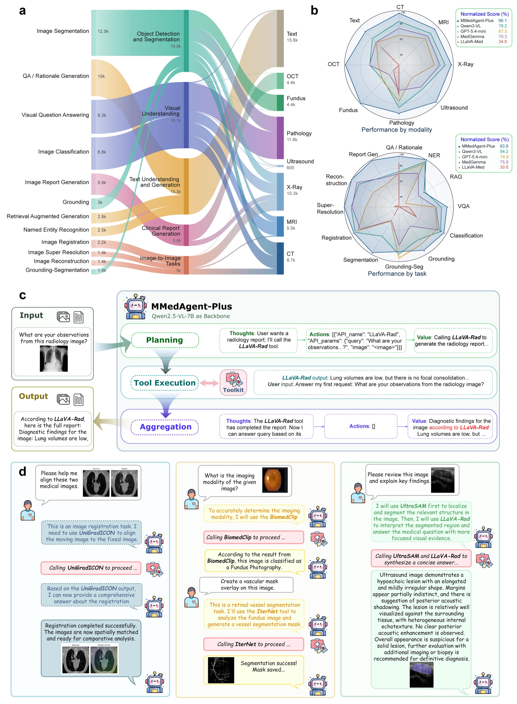
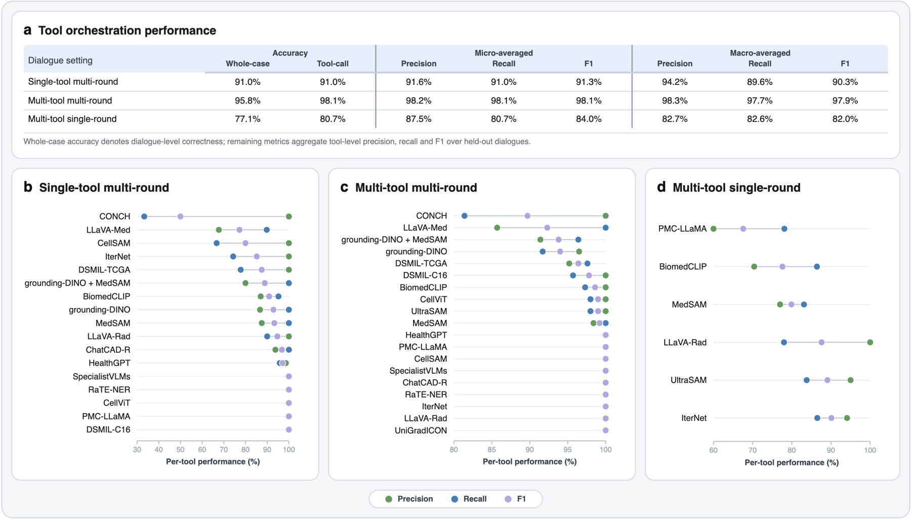
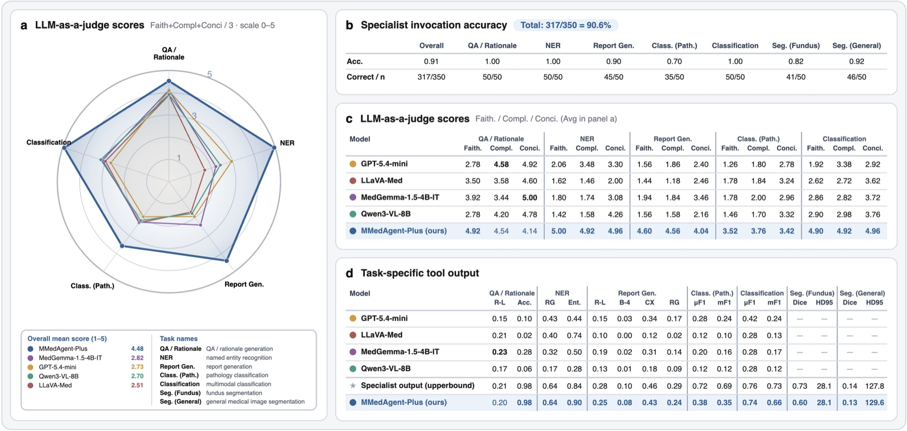

# MMedAgent-Bench: Benchmark and Evaluation for MMedAgent-Plus

[](http://www.apache.org/licenses/LICENSE-2.0)
[](http://www.apache.org/licenses/LICENSE-2.0)

Evaluation code and dataset-construction scripts for **MMedAgent-Plus**, a multimodal medical tool-use agent that coordinates 18 specialist models across 12 medical tasks and 8 modalities. The benchmark covers three dialogue settings: single-tool multi-round, multi-tool multi-round, and multi-tool single-round. It measures both **tool orchestration** (choosing the right tools in the right order) and **final-answer quality** (turning tool outputs into a faithful, complete and concise response).

[Paper (under review)] [[Model & Training: MMedAgent-Plus](https://github.com/RoxanneWAAANG/MMedAgent-Plus)] [[Dataset](https://huggingface.co/datasets/Roxanne-WANG/MMedAgent-V2)] [[Model](https://huggingface.co/ZihaoLin/mmedagent-nov24)]

> **Status:** partial release while the paper is under review. This release covers tool-calling evaluation, final-answer (LLM-as-a-judge) evaluation, and example dataset-construction scripts. Task-specific metrics, the remaining construction pipeline, the baseline scripts and the end-to-end execution harness will follow.

<div align="center">
    
</div>

## Current Tool List

| Task | Tool | Data Source | Imaging Modality | #Samples |
|---|---|---|---|---:|
| QA / rationale generation | [PMC-LLaMA](https://github.com/chaoyi-wu/PMC-LLaMA) | [PMC-LLaMA instructions](https://huggingface.co/datasets/axiong/pmc_llama_instructions), [PubMedQA](https://huggingface.co/datasets/qiaojin/PubMedQA), [MedQA-USMLE](https://huggingface.co/datasets/GBaker/MedQA-USMLE-4-options) | Text | 9,000 |
| Named entity recognition | [RaTE-NER](https://huggingface.co/Angelakeke/RaTE-NER-Deberta) | [RaTE-NER](https://huggingface.co/datasets/Angelakeke/RaTE-NER), [SumPubMed](https://github.com/vgupta123/sumpubmed) | Text | 4,500 |
| Retrieval-augmented generation | [ChatCAD-R](https://github.com/zhaozh10/ChatCAD)† | [Merck Manual](https://www.merckmanuals.com/) | Text | 2,528 |
| Visual question answering | [LLaVA-Med](https://github.com/microsoft/LLaVA-Med)† | [PMC article 60K-IM](https://github.com/microsoft/LLaVA-Med) | MRI, CT, X-ray, Histology, Gross | 16,687 |
| Classification (pathology) | [CONCH](https://github.com/mahmoodlab/CONCH) | [CRC100K](https://zenodo.org/records/1214456) | Pathology | 3,600 |
| Classification | [BiomedCLIP](https://huggingface.co/microsoft/BiomedCLIP-PubMedBERT_256-vit_base_patch16_224)† | [PMC article 60K-IM](https://github.com/microsoft/LLaVA-Med) | MRI, CT, X-ray, Histology, Gross | 7,923 |
| Tumor subtyping | [DSMIL-TCGA](https://github.com/binli123/dsmil-wsi) | [TCGA](https://portal.gdc.cancer.gov/) | Pathology (lung tumor) | 1,800 |
| Tumor detection | [DSMIL-C16](https://github.com/binli123/dsmil-wsi) | [Camelyon16](https://camelyon16.grand-challenge.org/Data/) | Pathology (breast tumor) | 1,800 |
| Grounding | [Grounding DINO](https://github.com/IDEA-Research/GroundingDINO)† | WORD, etc.* | MRI, CT, X-ray, Histology | 4,207 |
| Segmentation with text prompts (G-Seg) | [Grounding DINO](https://github.com/IDEA-Research/GroundingDINO) + [MedSAM](https://github.com/bowang-lab/MedSAM)† | WORD, etc.* | MRI, CT, X-ray, Histology | 2,303 |
| Segmentation with box prompts | [MedSAM](https://github.com/bowang-lab/MedSAM)† | WORD, etc.* | MRI, CT, X-ray, Histology, Gross | 5,765 |
| Segmentation (ultrasound) | [UltraSAM](https://github.com/CAMMA-public/UltraSam) | [US-SimSeg](https://www.kaggle.com/datasets/ignaciorlando/ussimandsegm), [Zenodo-US](https://zenodo.org/records/7272660), [TCIA-USG](https://www.cancerimagingarchive.net/collection/breast-lesions-usg/) | Ultrasound | 5,000 |
| Segmentation (fundus) | [IterNet](https://github.com/conscienceli/IterNet) | [STARE](https://cecas.clemson.edu/~ahoover/stare/), [Glaucoma-Benchmark](https://www.kaggle.com/datasets/deathtrooper/multichannel-glaucoma-benchmark-dataset), [Diabetic-Retinopathy](https://www.kaggle.com/datasets/ascanipek/eyepacs-aptos-messidor-diabetic-retinopathy) | Retina (fundus) | 4,500 |
| WSI cell segmentation | [CellViT](https://github.com/TIO-IKIM/CellViT) | -- | Pathology (WSI cell) | 1,800 |
| 2D cell segmentation | [CellSAM](https://github.com/vanvalenlab/cellSAM) | [CRC100K](https://zenodo.org/records/1214456) | Pathology (2D cell) | 1,800 |
| Registration | [UniGradICON](https://github.com/uncbiag/uniGradICON) | [EmoryReg](https://med.emory.edu/departments/radiation-oncology/research-laboratories/deformable-image-registration/downloads-and-reference-data/index.html), [Learn2Reg](https://learn2reg.grand-challenge.org/Datasets/), [HCP](https://db.humanconnectome.org/data/projects/HCP_1200) | CT, MRI | 5,000 |
| Reconstruction | [HealthGPT](https://github.com/DCDmllm/HealthGPT) | [NIH ChestX-ray](https://www.kaggle.com/datasets/nih-chest-xrays/data), [FastMRI](https://fastmri.med.nyu.edu/) | X-ray, MRI, CT, Ultrasound | 6,147 |
| Super-resolution | [HealthGPT](https://github.com/DCDmllm/HealthGPT) | [NIH ChestX-ray](https://www.kaggle.com/datasets/nih-chest-xrays/data) | X-ray, MRI, CT, Ultrasound | 4,593 |
| Report generation | [LLaVA-Rad](https://github.com/microsoft/LLaVA-Rad) | [LLaVA-Rad MIMIC-CXR](https://physionet.org/content/llava-rad-mimic-cxr-annotation/1.0.0/), [Stanford-AIMI](https://stanfordaimi.azurewebsites.net/datasets), [OpenI](https://openi.nlm.nih.gov/faq) | X-ray, MRI, CT, Ultrasound | 4,500 |
| Report generation (OCT) | [SpecialistVLMs](https://github.com/RobbieHolland/SpecialistVLMs) | [DeepOpht](https://github.com/Jhhuangkay/DeepOpht-Medical-Report-Generation-for-Retinal-Images-via-Deep-Models-and-Visual-Explanation) (non-public) | Retina (OCT) | 3,602 |
| **Total (single-tool)** | | | | **97,055** |

---

**Note**: † marks tools inherited from [MMedAgent](https://github.com/Wangyixinxin/MMedAgent); their instruction data is used in its original form. ``WORD, etc.*`` indicates various data sources including [WORD](https://github.com/HiLab-git/WORD), [FLARE2021](https://flare.grand-challenge.org/FLARE21), [BRATS](http://braintumorsegmentation.org/), [Montgomery County X-ray Set](https://data.lhncbc.nlm.nih.gov/public/Tuberculosis-Chest-X-ray-Datasets/Montgomery-County-CXR-Set/MontgomerySet/index.html), [VinDr-CXR](https://physionet.org/content/vindr-cxr/1.0.0/), and [CellSeg](https://neurips22-cellseg.grand-challenge.org/). The single-tool samples above are composed into multi-round and multi-tool dialogues, giving 208,928 training samples in total. Each tool keeps its original license; check the linked repositories before use.

## Usage

1. Clone this repo
```bash
git clone https://github.com/RoxanneWAAANG/MMedAgent-Bench.git
cd MMedAgent-Bench
```

2. Create environment
```bash
conda create -n mmedagent-bench python=3.11 -y
conda activate mmedagent-bench
pip install -r requirements.txt
```

Repository layout:

```
build_dataset/
  build_qa.py                  PubMedQA -> single-tool PMC-LLaMA dialogues (stage 1 example)
  single_tool_multiround.py    single-round -> multi-round dialogues (stage 2)
  corpus_pack/                 greeting / closing phrase banks used by stage 2
  dummy_images/                placeholder image for text-only tools
eval/
  tool_calling/
    tool_call_eval.py          run the agent on test dialogues, score tool calls
    generate_eval_metrics.py   precision / recall / F1, per-task, per-modality, confusion
    recalculate_multi_tool_single_round_llava_cap.py
  final_answer/
    final_answer_eval.py       LLM-as-a-judge: faithfulness, completeness, conciseness
  task_metrics/                to be released
```

## Data Download

### Benchmark Dataset

The annotations are hosted on Hugging Face: [Roxanne-WANG/MMedAgent-V2](https://huggingface.co/datasets/Roxanne-WANG/MMedAgent-V2).

A few demo images are available on Google Drive: [demo_images](https://drive.google.com/drive/folders/1-AfZ5Ox1nDgs1hNvNyGBWSBX8cwC0xtu?usp=sharing). They show the data format only; the full image set is not redistributed (see the note below).

```bash
huggingface-cli download Roxanne-WANG/MMedAgent-V2 --repo-type dataset --local-dir ./data
export MMEDAGENT_DATA_ROOT=$(pwd)/data
```

Note: The images themselves are not owned by us and therefore not included in our instruction data. If you use any images in the dataset, please follow their original licenses. If you would like to process the data and construct the full dataset, you can follow the instructions provided in the next section.

```
$MMEDAGENT_DATA_ROOT/
  test/
    single_tool_multi_round.jsonl   single-tool multi-round
    multi_tool_multiround.jsonl     multi-tool multi-round
    multi_tool_single_round.jsonl   multi-tool single-round
  train/
    ...
```

Image paths inside the JSONL files are relative to `MMEDAGENT_DATA_ROOT`.

### Constructing the Full Dataset

1. Download the source datasets listed in the [Current Tool List](#current-tool-list) from their original providers.
2. Build the dialogues with the scripts in [build_dataset/](build_dataset/).

The instruction data is assembled from public benchmarks with fixed request and response templates; no per-sample LLM generation is used. This release includes one first-stage builder and the second-stage multi-round expansion:

```bash
cd build_dataset

# Stage 1: source benchmark -> single-tool dialogues
python build_qa.py \
  --input  /path/to/pubmedqa_artificial.json \
  --output tool_instruct/pmc_llama_medqa_dataset.jsonl

# Stage 2: add greeting / closing rounds -> single-tool multi-round dialogues
python single_tool_multiround.py \
  --input "tool_instruct/*.jsonl" \
  --greetings corpus_pack/greetings.txt \
  --banks corpus_pack/phrase_banks.yaml \
  --output full_data/single_tool_multiround.jsonl
```

Both scripts take `--seed` (default 42). The builders for the other tools and the multi-tool composition scripts will be released later.

## Evaluation

### 1. Tool-calling Accuracy

<div align="center">
    
</div>

**Tool orchestration performance** on 500 held-out dialogues per setting. Whole-case accuracy requires the complete ordered sequence of tool calls in a dialogue to match the reference; the remaining metrics aggregate tool-level precision, recall and F1.

Run the agent on each split:

```bash
for split in single_tool_multi_round multi_tool_multiround multi_tool_single_round; do
  python eval/tool_calling/tool_call_eval.py \
    --test-jsonl $MMEDAGENT_DATA_ROOT/test/${split}.jsonl \
    --base-dir   $MMEDAGENT_DATA_ROOT \
    --checkpoint <path-or-HF-id-of-MMedAgent-Plus> \
    --max-samples 500 \
    --out-dir    outputs/tool_calling/${split/multiround/multi_round}
done
```

Then compute the metrics:

```bash
python eval/tool_calling/generate_eval_metrics.py \
  --data-root   $MMEDAGENT_DATA_ROOT \
  --results-dir outputs/tool_calling \
  --output-dir  outputs/tool_calling/reports
```

This writes `cross_split_summary.csv` (whole-case accuracy, tool-call accuracy, micro/macro P/R/F1), per-tool, per-task and per-modality tables, and confusion matrices.

In the multi-tool single-round split, the plain-LLaVA workflows (`MedSAM → LLaVA`, `IterNet → LLaVA`) are over-represented. `recalculate_multi_tool_single_round_llava_cap.py` recomputes the metrics with a cap on those cases:

```bash
python eval/tool_calling/recalculate_multi_tool_single_round_llava_cap.py \
  --turns-csv  outputs/tool_calling/reports/multi_tool_single_round/turns.csv \
  --output-dir outputs/tool_calling/reports/multi_tool_single_round_llava_cap
```

### 2. Final-answer Quality (LLM-as-a-judge)

<div align="center">
    
</div>

**End-to-end evaluation** across seven representative tasks (50 held-out cases each). MMedAgent-Plus is compared with four direct-answer vision-language baselines using the LLM-as-a-judge protocol below.

For each tool-use episode, the dialogue is replayed up to the tool output and the agent writes its final response. GPT-5.4-mini then scores three criteria on a 1–5 scale, one API call per criterion, each with its own rubric and three scored few-shot examples:

- **Faithfulness**: consistent with the tool output, with no unsupported claims.
- **Completeness**: includes the task-relevant information from the tool output.
- **Conciseness**: no irrelevant or redundant content.

```bash
export OPENAI_API_KEY=...
python eval/final_answer/final_answer_eval.py \
  --test-jsonl  $MMEDAGENT_DATA_ROOT/test/<split>.jsonl \
  --base-dir    $MMEDAGENT_DATA_ROOT \
  --checkpoint  <path-or-HF-id-of-MMedAgent-Plus> \
  --out-dir     outputs/final_answer/<split>
```

For tools whose output is an image, mask or file (MedSAM, IterNet, HealthGPT, UniGradICON, ...), a short acknowledgment counts as a complete answer. Responses that emit another tool call instead of answering ("wrong-context") receive the minimum score without being sent to the judge. Judge responses are cached in `<out-dir>/judge_cache.json`.

### 3. Task-specific Metrics

To be released. See [eval/task_metrics/README.md](eval/task_metrics/README.md) for the planned tools and metrics.

<!-- ## Citation
If you find this benchmark or code useful for your research, please cite our paper:

```bibtex
@article{mmedagentplus,
  title  = {MMedAgent-Plus: Scaling Multimodal Medical Agents across Modalities, Tasks and Workflows},
  note   = {Under review},
  year   = {2026}
}
``` -->

## License

The code is released under the [Apache-2.0 License](LICENSE). The instruction data is released under Apache-2.0; the images and the specialist tools keep the licenses of their original sources.

## Related Projects

The model and training code are in [MMedAgent-Plus](https://github.com/RoxanneWAAANG/MMedAgent-Plus). MMedAgent-Plus extends [MMedAgent](https://github.com/Wangyixinxin/MMedAgent).
